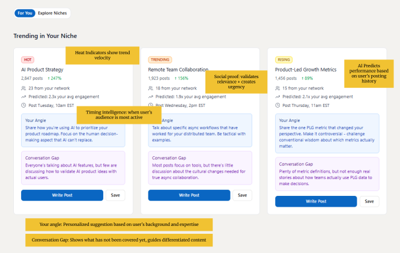
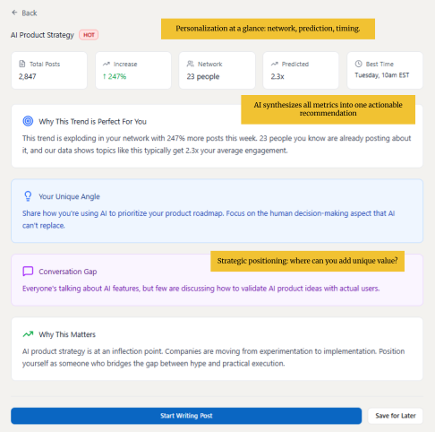
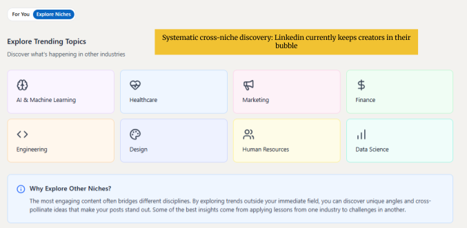
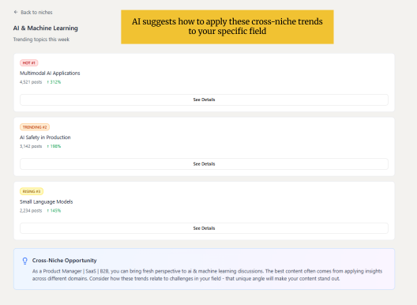

# Trend Radar

A product case study on helping LinkedIn creators join the right professional conversation, with a point of view that is actually theirs.

**[Open the interactive prototype](https://www.figma.com/make/J0EeBzNZLIAP5AQZyAE8mG/Trend-Radar-Web-App?t=JpXdiSy2yU2hzdN6-20&fullscreen=1)** · [Product plan](docs/product-plan.md) · [Original planning PDF](docs/My-LinkedIn-Idea.pdf)

Trend Radar is a personalized trend desk inside LinkedIn. It shows a creator which professional conversations are already moving in their niche, then hands them three things a trending list never does: an angle drawn from their own background, the part of the conversation nobody has covered, and a time their audience is actually there.

The prototype is set to one person, a product manager in SaaS and B2B. The system is designed to retarget itself from profile, posting history, and network. This is an independent case study about a concept for LinkedIn. It is not a LinkedIn product, and it is not affiliated with LinkedIn.

This is a concept and an interactive prototype, with a research plan and a measurement plan attached. The interviews and the lift numbers below are the bar the product would have to clear. They are targets, and they are labeled that way.

---

## The problem

LinkedIn’s Top Stories already shows that curated, in-product news can hold a professional’s attention and give them a reason to come back. That feed is built around general news and politics.

People open LinkedIn for a narrower reason: the conversation in their field, and whether they have something worth adding to it. Creators still do the hard part alone.

- Finding a topic is a hunt. There is no systematic view of what their community is talking about right now.
- The blank page shows up after the topic is chosen. The obvious take has already been posted, and a generic summary will not sound like them.
- Adjacent fields stay adjacent. A creator can notice a sharp idea in another industry and still have no bridge from “that is interesting” to “here is what it means for my work.”

The result is inconsistent posting, late posts on conversations that have already peaked, and feeds that stay inside one industry’s echo chamber.

## The product

Trend Radar answers four questions, in order. Each one is a different job, and each one is on its own surface in the prototype.

| The creator is asking | What they get |
| --- | --- |
| What is moving in my world? | A For You feed of trends ranked for their niche, with velocity, network proof, a predicted engagement lift, and a posting time |
| What would *I* say about it? | Two or three angles generated from their role, industry, and experience |
| What has nobody said yet? | A conversation gap: the uncovered part of the trend, so the post adds something |
| What can I borrow from outside my field? | An Explore view of other industries, translated back into their own work |

The inputs behind that are the creator’s LinkedIn profile, posting history, and past engagement; what their connections are posting and reacting to; and a live read of the platform, tracking engagement velocity, themes, and sentiment.

### A feed scoped to one niche

The home surface is For You. Heat is labeled in plain language (Hot, Trending, Rising) and backed by volume and week-over-week velocity. Social proof is specific: how many people in *this* network are already in the conversation. The prediction and the recommended time come from the creator’s own history and when their audience is active.

In the prototype, a SaaS product manager sees “AI Product Strategy” at 2,847 posts and +247% this week, with 23 people in their network already posting, a predicted 2.3× lift over their average, and a slot on Tuesday at 10am EST.

The yellow notes on these screens are the product rationale from the planning document, left on the artifact on purpose.

### A reason this trend fits this person

Opening a trend turns the card into a decision. The detail view restates the signals, then synthesizes them into one recommendation: why this trend is worth this person’s time. Under that sits the angle, the gap, and a short “why this matters” that frames the strategic position the post could take.

The call to action is **Start Writing Post**. That button is also the measurement hook: posts created from here can be compared with the creator’s historical baseline.

The angle in the prototype is specific to the persona. It tells the product manager to write about using AI to prioritize a roadmap, and about the human decision that AI does not make. The planning doc uses the same pattern with a different background: a PM with e-commerce experience, looking at the same trend, would be pointed at AI personalization and user privacy in checkout. The topic stays fixed. The point of view changes with the person.

### A way out of the echo chamber

Explore Niches is the cross-industry shelf: AI and machine learning, healthcare, marketing, finance, engineering, design, human resources, data science. The premise, written into the screen, is that the posts people remember usually borrow a lesson from somewhere else. LinkedIn’s current surfaces leave that borrowing to chance.

### A translation back into their field

Picking a niche shows what is moving there this week, ranked, with volume and velocity. The important block is at the bottom. Cross-Niche Opportunity restates who the viewer is and points the outside trend back at their own work.

A product manager in SaaS and B2B opening AI and Machine Learning is told they can bring a fresh perspective to multimodal applications, AI safety in production, and small language models, and that the post should connect those trends to challenges in their field.

## Why this has to be AI

A rules-based feed can rank hashtags and popular posts. It can produce a generic trending list. It cannot do the job this product is for.

Three things have to happen at once:

1. Read a very large, moving corpus of posts and score what is actually accelerating.
2. Read one person’s background well enough to propose an angle only they could sign.
3. Notice what a crowded conversation has left unsaid.

That third one is the difference between another post in the pile and a post worth publishing. Doing it by hand is a research project every morning. Doing it with a generic trending list sends creators back to the blank page. The model is the product, because the personalization and the gap-finding are the product.

## How I would validate it

I would treat the prototype as a hypothesis and run three passes before arguing to build it. The idea holds if the evidence shows all four of these:

- Creators struggle to post consistently because idea generation is the bottleneck.
- Creators miss trending conversations because discovery is accidental.
- Creators want adjacent topics and lack a tool that makes the jump cheap.
- Nothing they already use gives them a personal angle and a timing recommendation together.

**Interviews, 15 to 20 LinkedIn creators.** The interviews are about the workflow, and they are aimed at five questions:

- How do you currently find topics to write about?
- How often do you hit a blank page, where you are too overwhelmed to start or you do not know where to start?
- Does your content reach the community you were aiming at?
- Do you read outside your industry, and what stops you when you do not?
- When an idea from another field felt applicable to your work, what stopped you from posting it?

**Behavioral data, if LinkedIn usage data were available.** Posting frequency and consistency. Engagement on trend-based posts versus other posts. Whether the people who perform best are also the people posting on topics as they rise. The lag between a topic starting to move and a creator posting about it. On the existing Top Stories surface: click-through, time spent, and whether any of that turns into a post.

**A pass over the tools creators already pay for.** The question is which parts of content strategy and inspiration are covered, and which gap is still open. The gap I expect to find is personalized angle generation tied to timing. That expectation is the thing the scan is meant to test.

## How I would know it worked

Three primary metrics, each tied to one of the problems above. Targets are success criteria for a test, measured against a control or against the same person’s history.

| Metric | Target | What a hit would mean | How it would be measured |
| --- | --- | --- | --- |
| Content creation consistency | 40% more users posting at least twice a month | The blank-page problem is easing | Posting activity before and after adoption, via the LinkedIn API, against a control group |
| Engagement rate lift | 1.5× or better versus that person’s historical baseline | Angle, gap, and timing are doing real work | Posts created from **Start Writing Post**, compared with the creator’s own past performance |
| Cross-niche adoption | 25% of posts carry a perspective from outside the creator’s primary industry | The echo chamber is breaking | A visit to Explore before publishing, plus a short prompt: “Did you apply an insight from another industry?” |

Secondary metrics, because the primary three can move for the wrong reason:

- **Trend-to-post conversion, 15–20%.** Click from a trend detail through Start Writing Post, then a published post.
- **Time from discovery to publish, under 24 hours.** Timestamp the trend view and the publish.
- **Daily and monthly active use, and time in session.** Standard product analytics. A tool that helps people publish should be used on the days they publish, and it should be quick.

## What is in this repo

| | |
| --- | --- |
| This page | The case study: problem, product, prototype, validation plan, metrics |
| [docs/product-plan.md](docs/product-plan.md) | The planning document, transcribed for reading on GitHub |
| [docs/My-LinkedIn-Idea.pdf](docs/My-LinkedIn-Idea.pdf) | The original planning document |
| [Prototype](https://www.figma.com/make/J0EeBzNZLIAP5AQZyAE8mG/Trend-Radar-Web-App?t=JpXdiSy2yU2hzdN6-20&fullscreen=1) | The interactive Figma Make file |

Arya Sharma
