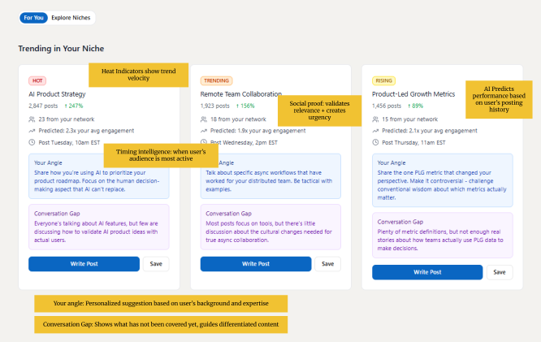
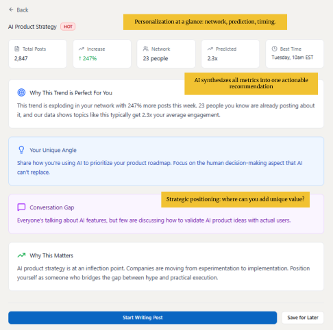
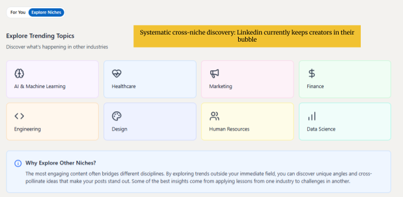
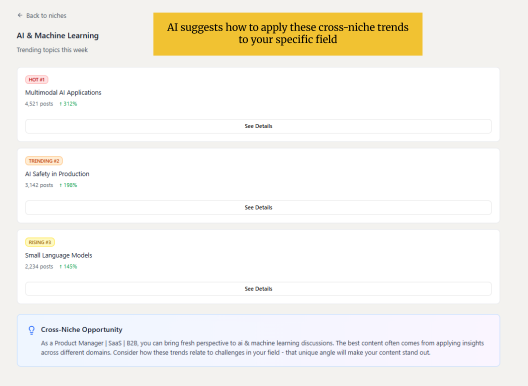

# Trend Radar — product plan

This is the planning document behind the [case study](../README.md). The sentences are the original plan. Formatting is cleaned up so the document can be read on GitHub. The source file is [My-LinkedIn-Idea.pdf](My-LinkedIn-Idea.pdf).

Prototype: [Trend Radar Web App on Figma Make](https://www.figma.com/make/J0EeBzNZLIAP5AQZyAE8mG/Trend-Radar-Web-App?t=JpXdiSy2yU2hzdN6-20&fullscreen=1)

---

LinkedIn’s “Top Stories” feature demonstrates smart content curation by highlighting relevant news that is currently trending, keeping professionals informed without leaving the platform. This positions LinkedIn as a networking tool and as a source of intelligence, increasing daily active usage and engagement.

The step above that: while LinkedIn News highlights broadly trending stories, it focuses primarily on general news and politics, ahead of the professional conversations and career-relevant topics users actually come to LinkedIn for. An improvement would cater to the career and educational reputation LinkedIn already has, and would help creators on the platform brainstorm ideas that are relevant to their niche, or even a niche next door. That is a trending dashboard of the most relevant topics per community, plus AI-powered recommendations for how to use those topics in a post.

## How we would know people want this

Three methods, used to validate the idea and to improve the solution.

### User research

Qualitative. Interview 15–20 LinkedIn creators to understand their content creation workflow and pain points. The interviews are aimed at these questions:

- How do you currently find topics to write about?
- How often do you experience blank-page paralysis: being too overwhelmed to write, or not knowing where to start?
- Do you feel like your content finds the audience, community, or niche you were targeting?
- Do you explore content outside of your industry, and if not, what prevents you?
- When you see interesting ideas from other fields, have you ever thought “I could apply this to my work”? What stopped you from posting about it?

### Behavioral data

Quantitative. Explore LinkedIn usage data for:

- Posting frequency and consistency among creators
- Engagement rates on trend-based posts versus other posts
- Correlation between top performers and posting on trending topics
- Time lag between when a topic begins trending and when creators post about it
- Trending Stories metrics: click-through rate, time spent, and conversion to posting

### Market research

Research the tools creators already use for content strategy and inspiration. Identify what those tools do, and which gaps are still open.

### What would count as validation

The idea is validated if there is clear evidence of all of the following:

- Creators struggle with consistent posting because of idea generation
- Creators miss trending conversations because discovery is unsystematic
- Creators want to explore adjacent topics and lack a tool that lets them do it efficiently
- No existing tool provides personalized angle generation together with timing intelligence

## AI inputs

1. **User context**, so the trending options can be personal to the user’s community. LinkedIn profile (role, industry, skills, experience), posting history, and engagement patterns on past posts.
2. **Network activity.** What the user’s connections are posting about and engaging with.
3. **Platform-wide content.** Real-time analysis of posts across industries, tracking engagement velocity, conversation themes, and sentiment.

## AI outputs

1. **Personalized trend discovery.** Surface trends that are relevant to the user’s niche. A generic trending list shows what is popular. This shows what is popular *for them*.
2. **Your Angle.** For each trend, suggest 2–3 perspectives the user could take from their specific background. A PM with e-commerce experience looking at “AI Product Strategy” might be prompted to share how they balance AI personalization with user privacy in checkout flows. The point is authenticity: the user writes their own view of a trending topic.
3. **Conversation gap analysis.** Identify what the trending conversation has not covered yet, and point the user at a contribution that adds something.
4. **Engagement prediction and timing.** From the user’s historical performance and their network’s activity, predict engagement potential (for example, 2.3× their average post) and a posting time (for example, Tuesday at 10am EST, when 73% of their audience is active).

## Why AI, when a simpler system could rank posts

A rule-based system could show trending hashtags or popular posts. Personalization at this scale is a different problem. The model has to analyze a very large volume of posts across industries as they happen, understand one user’s background well enough to suggest an angle only they could authentically take, and find conversation gaps a person skimming the feed would miss.

Without that, the workflow collapses into a manual research process, or into a generic trending list that does not help a creator produce a differentiated post. Either way, idea generation and the echo chamber stay unsolved.

## The prototype

The interactive prototype is a Figma Make file:

https://www.figma.com/make/J0EeBzNZLIAP5AQZyAE8mG/Trend-Radar-Web-App?t=JpXdiSy2yU2hzdN6-20&fullscreen=1

Annotated screens from that prototype are in the [case study](../README.md#a-feed-scoped-to-one-niche).

## Success metrics

Three primary metrics, chosen because they test the problems above.

1. **Content creation consistency.** Posting frequency among Trend Radar users versus a control group. Posting activity before and after adoption, collected via the LinkedIn API. Target: a 40% increase in users posting at least twice a month. That is the test of whether blank-page paralysis and idea generation are actually being addressed.

2. **Engagement rate lift.** Average engagement on posts created with Trend Radar, tracked when they are created from the “Start Writing Post” button, versus the user’s historical baseline. Target: 1.5× or better. That is the test of timing, angle generation, and conversation gap analysis.

3. **Cross-niche content adoption.** The share of posts that bring in an insight from outside the user’s primary industry. Tracked if the user visited Explore before posting, or with a survey question: “Did you apply insights from another industry?” Target: 25% of posts include a cross-niche perspective. That is the test of whether the tool breaks the echo chamber.

### Secondary metrics

1. **Trend-to-post conversion, target 15–20%.** Clicks from a trend detail to “Start Writing Post,” and the publishing that follows.
2. **Time from trend discovery to publishing, target under 24 hours.** Timestamp the view of the trend and the publish.
3. **Daily and monthly active usage, and time spent per session.** Tracked with product analytics.
